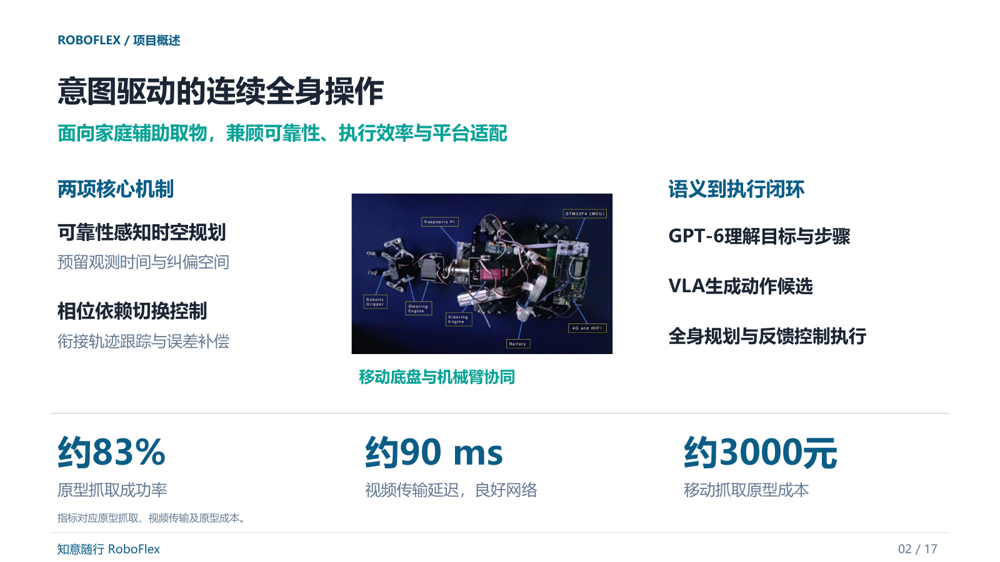
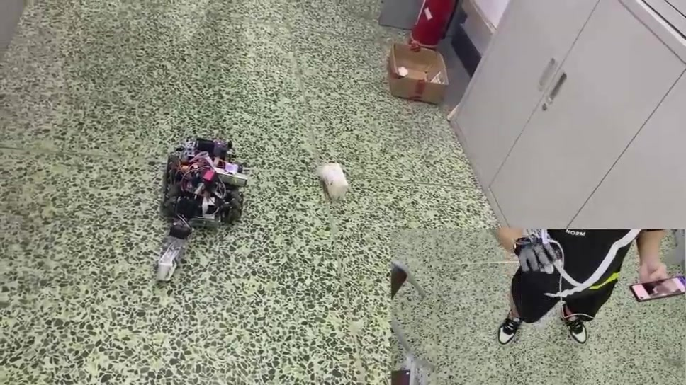
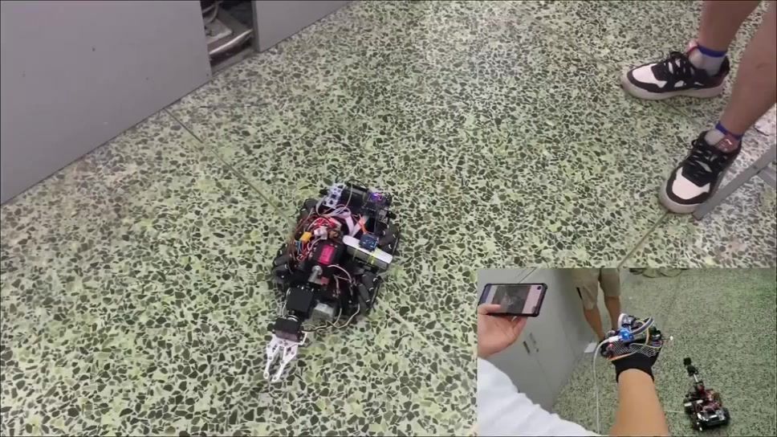

# 知意随行 RoboFlex

面向家庭辅助取物的意图交互与连续操作项目。整体方案结合GPT-6语义理解、VLA动作策略、可靠性感知的时空全身规划与相位依赖切换控制。



快速入口：[作品介绍 PDF](presentation/知意随行_作品介绍.pdf) · [系统架构](docs/system_architecture.md) · [接口与任务状态](docs/system_interfaces.md) · [方法来源](docs/method_sources.md)

## 原型实拍视频

[](media/robot-demo.mp4)

[查看视频文件](media/robot-demo.mp4)：约 66 秒，静音，保留原演示的 1.5 倍播放速度。H.264 MP4 格式；GitHub 文件页点击 `View raw` 可获取视频，在浏览器或本地播放器中播放。

### 基础运动模式

[](media/basic-motion.mp4)

[查看基础运动模式视频文件](media/basic-motion.mp4)：约 29 秒，保留原始画质和声音。GitHub 文件页点击 `View raw` 可获取视频。

下载仓库后，双击demo/index.html可查看离线交互演示。随附代码的具体运行方式如下。


本工程随附于知意随行比赛材料，提供交互与参考取放的运行入口。整体系统由GPT-6理解图像与用户意图，任务管理组织目标与步骤，动作策略、时空全身规划与相位控制衔接执行。工程模块见 [运行说明](docs/competition_scope.md)。无需安装即可打开 `demo/index.html` 查看离线交互回放。

本工程对应家庭辅助取物流程：**从连续手部动作推断候选目标，以共享自主完成确认、取消和受约束的取放。** 用户无需语音输入。Python 3.10 及以上可运行，默认使用仿真机械臂。

随附意图模块使用几何特征、时间平滑和“无意图”竞争假设，参考执行使用几何取放策略。GPT-6语义任务通过整体架构的任务接口衔接，当前软件入口按本文配置运行。可分别通过 `IntentEstimator` 和 `ExecutionPolicy` 接入学习模型与经过机器人适配的 VLA。

## 1. 先运行，无需摄像头或下载模型

建议将代码包解压到较短路径，例如 `D:\RoboFlex`，进入包含本 README 的目录后执行：

```powershell
python -m roboflex demo
```

正常会出现：

```text
OBSERVING  -> CONFIRMING -> EXECUTING -> COMPLETE
观察连续线索    请求确认      取放并返回原位   指令执行完毕
```

Windows 也可在此目录用 `powershell -ExecutionPolicy Bypass -File .\run_demo.ps1` 启动。脚本会寻找可用 Python，不安装软件、不连接硬件。

以下情景均使用**合成输入**，用于检查逻辑，不代表项目真实成功率：

```powershell
python -m roboflex demo --scenario ambiguous     # 相邻目标不明确，不启动
python -m roboflex demo --scenario no-intent     # 日常静止姿态，不选物
python -m roboflex demo --scenario withdraw      # 已选目标后撤回，取消
python -m roboflex demo --scenario cancel        # 执行中取消
python -m roboflex demo --scenario stale         # 图像输入过期，中止
python -m roboflex demo --scenario target-shift  # 抓取前目标移动，重新确认
python -m roboflex demo --scenario stale-glove   # 过期手套消息不能确认
python -m roboflex demo --wire                   # 实时本地 TCP 固件模拟器
python -m unittest discover -s tests -v
```

`--wire` 会在本机临时端口启动 Python 模拟固件，验证握手、动作完成确认、停止和看门狗，不连接真实机器人。

## 2. 摄像头版

创建独立环境，安装可选依赖：

```powershell
python -m venv .venv
.\.venv\Scripts\python.exe -m pip install -e ".[vision,serial]"
.\.venv\Scripts\python.exe -m roboflex download-model
.\.venv\Scripts\python.exe -m roboflex markers
.\.venv\Scripts\python.exe -m roboflex camera --model models/hand_landmarker.task
```

这次通过验证的依赖版本另存于 `requirements-vision-tested.txt`；需要复现同一环境时，可先安装该文件，再执行 `pip install --no-deps -e .`。预生成的两张标记图已放在 `markers/`。

把 `markers/marker_0.png`、`marker_1.png` 打印后分别固定在两个测试物体上，保留白边。默认对应杯子和纸盒。把自己的手与物体放在同一画面内，摄像头画面不镜像；如识别到另一只手，使用 `--hand Left`。这些标记先提供稳定、可解释的目标 ID；后续可用目标检测／分割网络替换，不需要改控制状态机。

交互方式：

- 连续指向或伸手接近目标，候选稳定后进入 `CONFIRMING`。
- 按 `C` 确认；也可在选定后用拇指和食指捏合保持约 0.35 秒。选物前已经保持捏合时，必须先松开再确认。
- 按 `X` 或明显撤回取消；空格使软件停止状态锁定。
- 按 `R` 显式复位状态；按 `Q` 退出。
- 任意取消、故障或完成后，都不会自动开始下一次抓取。

默认摄像头版仍是 **mock**：真实模型输出手部关键点和标记检测，机械臂仅做软件执行。未提供相机标定时，三维坐标来自演示配置中的虚拟固定点，屏幕会明确显示 `SIMULATION`。这不表示能从普通 RGB 图像直接获得真实机器人坐标。没有拍到同一空间中的用户与物体时，不能把手套朝向直接当作远端物体坐标。

摄像头采集由上述命令启动。

## 3. 意图识别具体做了什么

视觉输入包含物体 ID、图像位置、手腕、食指根部和指尖，以及可选的完整 21 个手部关键点。它从以下线索构建逐目标支持分数：

1. **指向关系**：食指方向与候选物体的夹角、距离。
2. **接近趋势**：指尖运动是否接近物体，而不是单帧距离小就抓。
3. **可选手套**：经用户标定的弯曲变化支持动作阶段；陀螺仪只补充“正在运动”的线索，不推算目标位置。
4. **无意图假设**：视觉不支持任何对象、手消失或目标不明确时，保留“不操作”。
5. **时间约束**：按实际时间做平滑、候选间隔判断和持续观察；不会因摄像头帧率高就更快启动。

`Intent.probabilities` 是归一化的启发式支持分数，**不是经过统计校准的真实概率**。默认阈值适合验证流程，实际用户的动作范围、遮挡和光照需要采集数据后调整。第一版最适合能够表达目标、但难以持续操控机械臂的用户；不把无法伸手或无法指向的用户适配能力视为已完成。

确认后的执行目标会锁定。目标变化、撤回、画面过期、跟踪持续丢失会中止；不会把正在运行的杯子任务偷偷换成纸盒任务。停止后保持当前夹爪状态，避免自动松爪丢物。

## 4. 机械臂代码与真实硬件接入

`planning.py` 实现了**底座偏航＋肩关节＋肘关节＋腕俯仰的四轴参考机构**：逆运动学、正运动学、关节角限制、速度限制、桌面抓取轨迹和预设托盘交接。整体计划先验证，再发送动作。默认连杆长度、原位和交接点都是演示值，尚未匹配实际机器人机构。

动作流程：张开 → 安全高度 → 目标上方 → 下降 → 合爪 → 提升 → 托盘上方 → 放下 → 松爪 → 回到原位。取消时不会盲目回原位。恢复中断的真实机械臂需要操作者先处理夹持物和姿态。

硬件适配主要修改：

- `config/hardware.template.json`：实测连杆长度、工具偏置、关节范围、原位、工作空间、托盘与物体参数。
- `camera_calibration`：实测相机内参、畸变、相机到机械臂基座的变换。格式见 [标定说明](docs/calibration.md)。
- STM32 / ESP32 / ROS 桥接层：把 [JSONL 协议](docs/protocol.md) 的数学关节角转换成设备驱动需要的舵机脉宽或关节命令。

串口形式示例，只有完成真实测量和固件适配后才使用：

```powershell
python -m roboflex camera --config config/hardware.json --backend serial --arm-port COM5 --allow-motion
```

Wi-Fi / 有线 TCP 桥接形式：

```powershell
python -m roboflex camera --config config/hardware.json --backend tcp --host 192.168.1.50 --port 8765 --allow-motion
```

物理执行需要显式 `--allow-motion`、实测配置 `calibration_verified=true`、相机标定和通过握手的固件。普通舵机控制器若不实现本项目协议，不能直接拿这条命令连接；已有驱动可以通过 `ArmBackend` 接口适配。四轴参考 IK 不适用于任意六轴臂，也不能把带负号的数学关节角直接写进 0–180 度舵机。

当前几何检查覆盖末端工作空间与静态禁入盒，**没有全臂碰撞检测、人体保护、夹持力反馈或抓取成功检测**。只用于清空并隔离的受控测试台；后续家庭产品需要独立本地保护与实测。空格键是软件停止，不能替代物理停止回路。`COMPLETE` 只代表指令序列完成，不能当作真实抓取成功。

## 5. 可选传感手套

```powershell
python -m roboflex camera --glove-port COM6
```

手套每行发送一个 UTF-8 JSON：

```json
{"seq":101,"bends":[0.10,0.22,0.19,0.15],"gyro_dps":[1.2,-0.7,3.1],"confirm":false,"cancel":false}
```

`bends` 先按用户的伸直／弯曲范围归一化到 0–1；`seq` 严格递增，重启手套后重新连接。`confirm/cancel` 是显式事件，不能把任意弯曲都作为确认。接收线程记录主机到达时间，过期数据不参与融合；这只是第一版时间对齐，尚未实现硬件时钟同步和网络延迟补偿。手套是可选项，不佩戴也能运行视觉路径。

## 6. 记录、回放与下一轮研究

每次运行生成 `runs/*.jsonl`，包含观测、21 个关键点（摄像头模式）、可选传感、各目标支持分数和控制决策。默认不保存原始视频，不会把数据发送到云端。

```powershell
python -m roboflex demo --log runs/demo.jsonl
python -m roboflex replay runs/demo.jsonl --log runs/replayed.jsonl
python -m roboflex evaluate runs/demo.jsonl
```

真人实验可逐段补 `expected_target`，没有取物意图标为 `__none__`；暂不能确定的帧保持 `null`。评估脚本统计带标注帧的预测、误选帧和执行状态事件，尚不计算真实抓取成功率。合成演示的指标只用于检查程序。真实研究还需要按用户／会话隔离训练与测试，加入相邻目标、自然动作、遮挡、撤回和改目标数据，并记录意图确认、取消响应与完整任务成败。

意图与策略对照可采用：手势遥操作 → 纯视觉时序 → 视觉＋可选传感 → 同一意图模块分别接几何策略与适配 VLA。`IntentEstimator.update()` 返回统一 `Intent`；`ExecutionPolicy.plan()` 接收已确认目标与机器人当前状态。GPT-6输出目标或步骤，动作策略形成执行候选，再由规划和本地控制完成约束检查及反馈执行。连续操作的规划与控制对照设计见系统方案。

## 7. 代码位置

| 文件 | 作用 |
|---|---|
| `roboflex/intent.py` | 时序意图基线、无意图与撤回 |
| `roboflex/controller.py` | 共享自主状态机和确认／取消 |
| `roboflex/planning.py` | 四轴 IK、取放轨迹与限制 |
| `roboflex/vision.py` | MediaPipe 手部、ArUco 与标定坐标 |
| `roboflex/glove.py` | 可选手套串口采集 |
| `roboflex/wire.py` | TCP／串口机械臂桥接、ACK 与看门狗 |
| `roboflex/bridge_sim.py` | 本地模拟固件 |
| `roboflex/demo.py` | 可复现的合成测试情景 |
| `roboflex/evaluation.py` | 离线指标 |
| `tests/` | 意图、控制、几何、通信与视觉测试 |

官方接口依据：[MediaPipe Hand Landmarker Python](https://developers.google.com/edge/mediapipe/solutions/vision/hand_landmarker/python)、[模型说明](https://developers.google.com/edge/mediapipe/solutions/vision/hand_landmarker)、[OpenCV ArUco](https://docs.opencv.org/4.x/d5/dae/tutorial_aruco_detection.html)。下载脚本只使用官方模型地址；第三方模型和依赖按各自许可使用。


## 整体系统架构

整体架构连接感知状态、GPT-6理解、任务管理、动作策略、时空全身规划与相位反馈控制。详见 [系统方案](docs/system_architecture.md)、[接口与任务状态](docs/system_interfaces.md)、[方法来源](docs/method_sources.md)。模块契约见上述文档，随附代码运行配置见本README。连续全身优化器与平台专用驱动由对应研究平台承载。
