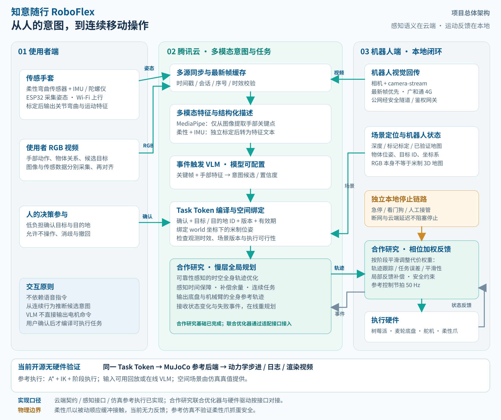
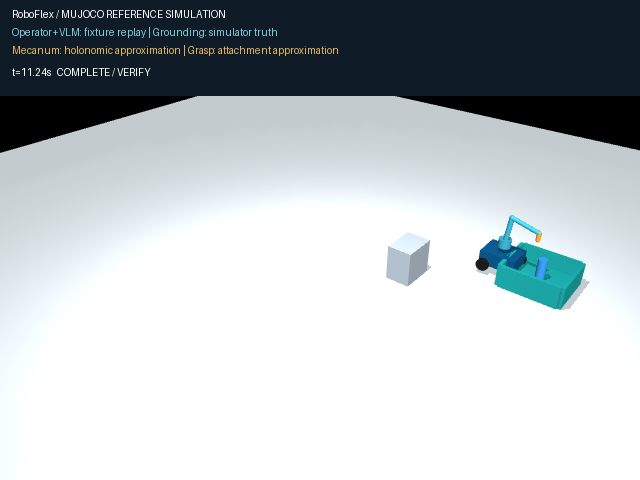
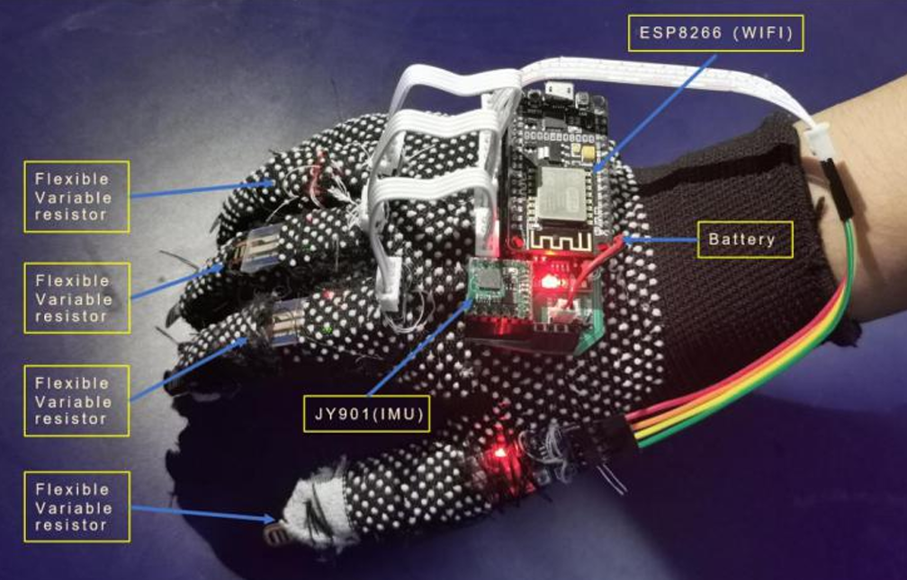
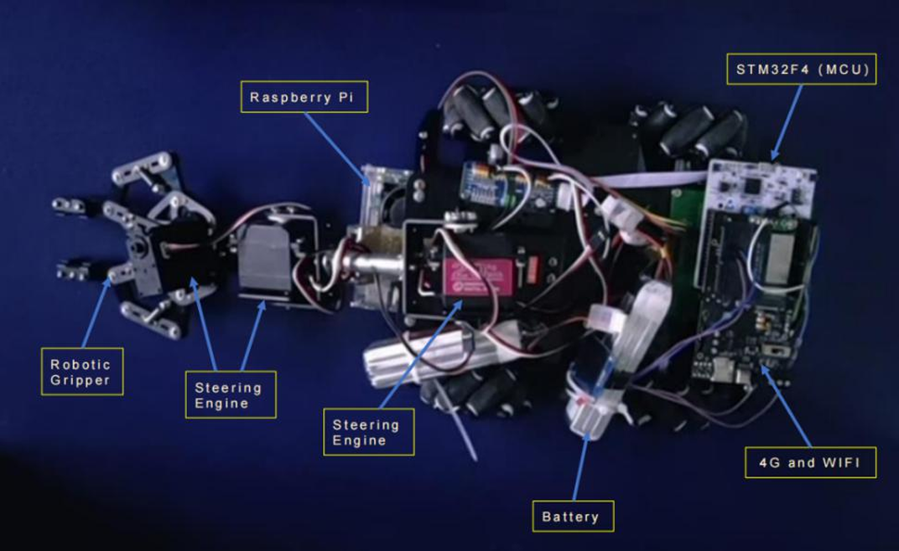
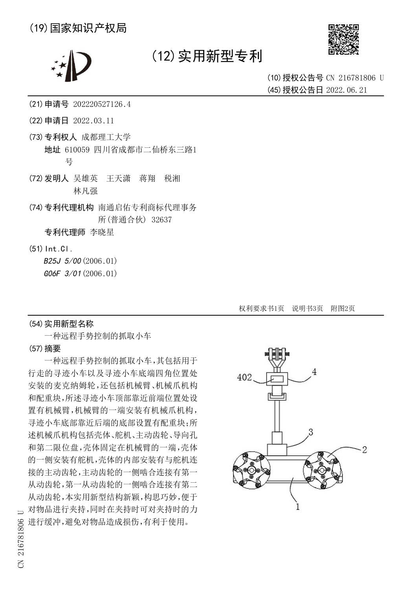

# 知意随行 RoboFlex

**基于多模态意图理解与具身空间推理的辅助取物机器人。** 面向行动不便者及照护家庭，将用户不完整的指向、伸手与撤回线索组织为可确认的取物目标，再连接连续移动操作系统，完成接近、抓取、携行、放置和结果核验。

项目把**意图理解与任务执行**连成闭环：用户不必持续遥控每个关节，机器人也不必先具备处理所有家务的通用自主能力。首个应用范围是单一生活区域、短距离轻小件和预设交接托盘。

[系统方案](docs/system_architecture.md) · [云端与小车工程](docs/cloud_stack.md) · [无硬件开发](docs/no_hardware.md) · [项目沿革](docs/development_background.md) · [作品介绍 PDF](presentation/知意随行_作品介绍.pdf) · [验证记录](VERIFICATION.md)

## 从用户意图到物理任务



手套的柔性弯曲传感器与IMU提供运动线索，操作端视频提供手部与物体关系。MediaPipe从**图像**提取关键点；传感器数据单独编码，两者形成带来源和单位的结构化描述。云端VLM结合视频关键帧、描述与场景候选推断意图，任务编译器将已确认目标绑定到有效的物体ID、位置与版本，输出 **Task Token**。

执行侧连接合作研究中的**可靠性感知时空全身规划与相位依赖控制**：联合考虑底盘、机械臂与任务时长，为目标观测及误差补偿留出条件，依据实时反馈完成任务推进与重新规划。合作研究及原始署名见[方法来源](docs/method_sources.md)。本仓库新增了可复现的云端接口、任务契约和MuJoCo参考闭环；合作研究的完整优化器与平台专用驱动由对应研究平台承载。

| 环节 | 本仓库可运行入口 | 与完整系统的衔接 |
|---|---|---|
| 手部与视频输入 | MediaPipe摄像头基线、传感特征编码、最新帧缓冲、camera-stream适配器 | 接操作端与小车视频，完成时间同步和空间标定 |
| 语义意图 | 明确标注的回放提供器，或配置真实VLM服务 | 选择已有实体，保留无意图、澄清与取消 |
| 任务绑定 | 严格JSON、显式确认、时效与目标版本检查 | 当前Task Token表达一次取放，连接连续多任务系统 |
| 移动操作 | MuJoCo中的平面A*、四轴IK、阶段执行与落点核验 | 提供参考基线，对接合作研究规划器及适配后的VLA动作候选 |
| 本地控制 | 参考执行的取消、控制租约、故障及目标变化处理 | 本地停止、设备反馈与硬件保护独立于云端推理 |

VLM输出目标与语义建议；VLA输出经过机器人适配的动作候选，两者职责不同。这里的参考执行器不等同于完整全身优化器，也未内置训练完成的VLA权重。

## 无硬件先跑完整闭环

Python 3.10及以上。建议创建独立环境后，在仓库根目录安装仿真可选依赖：

```powershell
python -m pip install -e ".[sim]"
python -m roboflex simulate --scenario success --video --output runs/success-01
```

输出目录包含 `simulation.mp4`、`preview.png`、逐控制周期的 `trace.jsonl`、`intent_result.json` 和 `report.json`。每次使用新的空目录，保留此前实验记录。

[](media/simulation-reference.mp4)

[查看本次仿真视频](media/simulation-reference.mp4) · [对应报告与逐周期日志](examples/reference_run/)。本次回归100项，96项通过，4项旧视觉依赖测试跳过；六类仿真情景均符合预期。

视频由MuJoCo中的实际状态渲染，任务成功通过物体释放并落入托盘核验。默认操作端特征与VLM结果是**合成／回放输入**，空间坐标来自仿真真值；这条命令验证接口与执行链，不测量真实意图识别准确率。麦轮采用全向运动近似，抓取采用距离门限与附着约束，不模拟柔性手指的接触力学。

| 情景 | `--scenario` | 观察重点 |
|---|---|---|
| 正常取放 | `success` | 抓取、携行、释放与落点核验 |
| 没有操作意图 | `no-intent` | 保持等待，不启动取物 |
| 携物时取消 | `cancel` | 停止推进并保留夹持状态 |
| 控制链路失联 | `network-loss` | 本地租约过期停止 |
| 抓取前目标移动 | `target-shift` | 更新目标并重新规划 |
| 无可行路径 | `blocked` | 拒绝继续执行并报告故障 |

```powershell
python -m roboflex simulate --scenario cancel --output runs/cancel-01
python -m roboflex simulate --scenario network-loss --output runs/network-01
python -m roboflex simulate --scenario target-shift --output runs/shift-01
python -m unittest discover -s tests -v
```

真实API、真实操作端视频和硬件可逐层替换；[无硬件开发路线](docs/no_hardware.md)说明每一步应保存的证据。AI生成视频可用于产品设想展示，不能替代闭环执行验证。

## 运行云端意图服务

先启动本地回放服务，再在另一个终端连接：

```powershell
python -m roboflex cloud --provider replay
python -m roboflex simulate --gateway http://127.0.0.1:8766 --output runs/gateway-01
```

使用真实、支持图像输入及相应消息格式的模型服务时，配置实际可用模型标识。代码不写死模型名称：

```powershell
$env:ROBOFLEX_VLM_BASE_URL = "https://your-model-endpoint.example/v1"
$env:ROBOFLEX_VLM_MODEL = "your-available-vision-model-id"
$env:ROBOFLEX_VLM_API_KEY = "your-api-key"
python -m roboflex cloud --provider live
```

占位值需替换，密钥不要提交GitHub。`/v1/intent`产生语义建议；推理耗时使原观测过期时返回 `AWAITING_FRESH_CONFIRMATION`。客户端重新采集当前场景与明确确认，再向 `/v1/tasks`提交，不能给旧画面改时间戳。`/v1/cancel`使待处理建议失效，本地停止链路仍需独立执行。[接口与腾讯云部署说明](docs/cloud_stack.md)包含完整流程。

## 真实硬件与已有成果

当前链路：**柔性传感器＋IMU＋ESP32 Wi-Fi手套 → 腾讯云 → 树莓派＋广和通4G＋麦轮底盘＋舵机机械臂＋柔性机械爪**。小车视频通过camera-stream接入。柔性结构提供被动顺应性；未配置力传感器时不提供可测的夹持力反馈。

| 手套历史原型 | 移动抓取历史原型 |
|---|---|
|  |  |

手套照片记录ESP8266版本；当前方案采用ESP32，保留原图说明项目演进。平台实拍保留历史控制器和通信配置，不将照片标签改成新硬件。

[](media/robot-demo.mp4)

[原型抓取视频](media/robot-demo.mp4)约66秒、静音、保留原片1.5倍速；[基础运动视频](media/basic-motion.mp4)约29秒。两段均为已有原型实拍，与新增仿真分别展示。GitHub文件页可通过 `View raw`获取MP4。

原型已抓取空水杯、纸盒、网球、乒乓球和生鸡蛋；**约83%为该原型抓取成功率，约90 ms为良好网络下视频传输延迟，约3000元为该原型成本**。它们不是完整意图辅助任务的新测试结果，也不是云端模型时延或工程产品报价。

相关实用新型专利：《一种远程手势控制的抓取小车》，授权公告号 **CN 216781806 U**。



## 摄像头基线与模块位置

原有离线Demo、摄像头意图基线、串口／TCP桥接及四轴取放保留：

```powershell
python -m roboflex demo
python -m pip install -e ".[vision]"
python -m roboflex download-model
python -m roboflex camera --model models/hand_landmarker.task
```

摄像头命令默认mock执行；实际设备需要实测机构配置、相机标定及匹配协议的驱动。操作参见[原有运行说明](docs/legacy_readme.md)、[标定](docs/calibration.md)与[设备协议](docs/protocol.md)。无需安装也可打开 `demo/index.html`查看合成观察回放。

| 位置 | 作用 |
|---|---|
| `roboflex/stack/perception.py`、`streams.py` | 手部特征、时序窗口、事件触发及camera-stream输入 |
| `roboflex/stack/vlm.py`、`service.py` | 模型提供器、云端推理与确认接口 |
| `roboflex/stack/contracts.py` | 场景实体、Task Token、目标绑定与有效期 |
| `roboflex/stack/motion.py`、`simulation.py` | 麦轮映射、参考路径、IK、阶段执行与本地停止 |
| `roboflex/stack/runner.py`、`scene.xml` | 实验、MuJoCo场景、日志及视频导出 |
| `roboflex/stack/planner_bridge.py` | 合作研究规划器的数据适配契约与返回轨迹校验 |
| `roboflex/stack/hand_input.py` | 真实静态图像与手套JSON生成结构化描述 |
| `roboflex/intent.py`、`controller.py`、`vision.py` | 原有视觉时序意图与共享自主基线 |
| `tests/` | 意图、契约、执行、通信及仿真回归 |

## 研究与工具来源

连续移动操作基于合作研究 [Synergizing Efficiency and Reliability for Continuous Mobile Manipulation](https://arxiv.org/abs/2604.05430)，保留原始方法署名。语义任务组织参考 [HINT-Plan](https://arxiv.org/abs/2609.17771)；手部结构化描述参考 [GestOS](https://arxiv.org/abs/2509.14412)。这些研究分别提供方法启发，不代表其权重或实现已打包进本仓库。

工具接口依据：[MuJoCo](https://mujoco.readthedocs.io/)、[MediaPipe Hand Landmarker](https://developers.google.com/edge/mediapipe/solutions/vision/hand_landmarker/python)、[camera-stream 0.3.8](https://pypi.org/project/camera-stream/0.3.8/)、[OpenCV ArUco](https://docs.opencv.org/4.x/d5/dae/tutorial_aruco_detection.html)。许可与成果说明见 [THIRD_PARTY.md](THIRD_PARTY.md) 和 [LICENSE_NOTICE.md](LICENSE_NOTICE.md)。
